# TaskFlow — Intelligent Personal Productivity

Aplicativo Android nativo de produtividade pessoal: **comandos de voz em português** (criar, concluir, apagar e listar tarefas falando, com resposta em voz alta), priorização inteligente explicável, planejamento diário, hábitos com sequências, calendário, estatísticas, lembretes, widget e backup. **100% offline**, sem conta, sem internet, sem analytics.

> **APK pronto:** [`release/TaskFlow-1.3.0.apk`](release/TaskFlow-1.3.0.apk) (assinado em modo release, ~3,7 MB, Android 8.0+). Instala por cima das versões anteriores sem perder dados.

## Capturas de tela

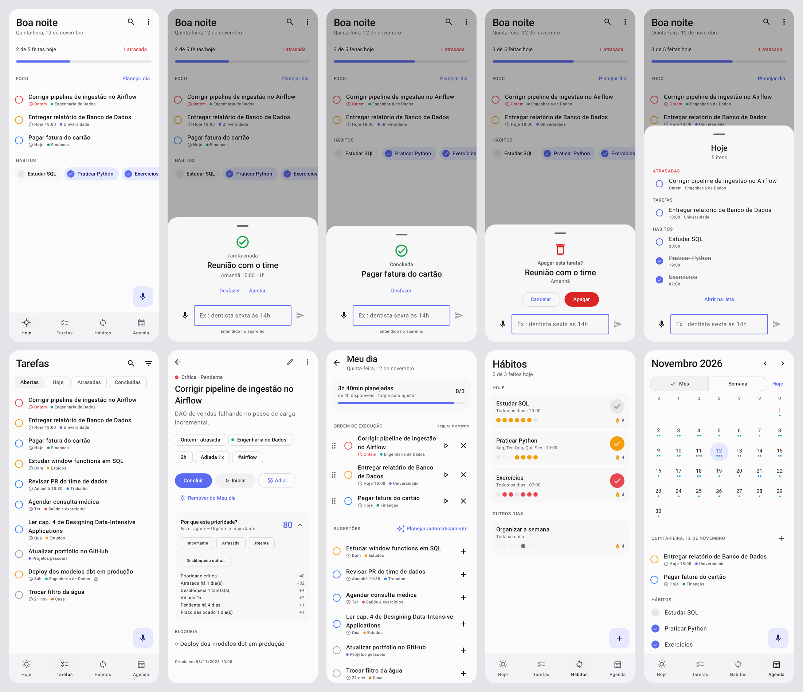

| Hoje | Voz: criar | Voz: concluir | Voz: apagar | Voz: listar |
|---|---|---|---|---|
| 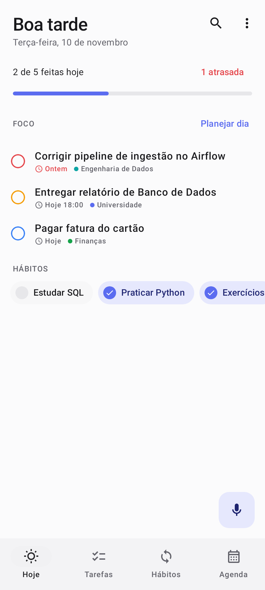 | 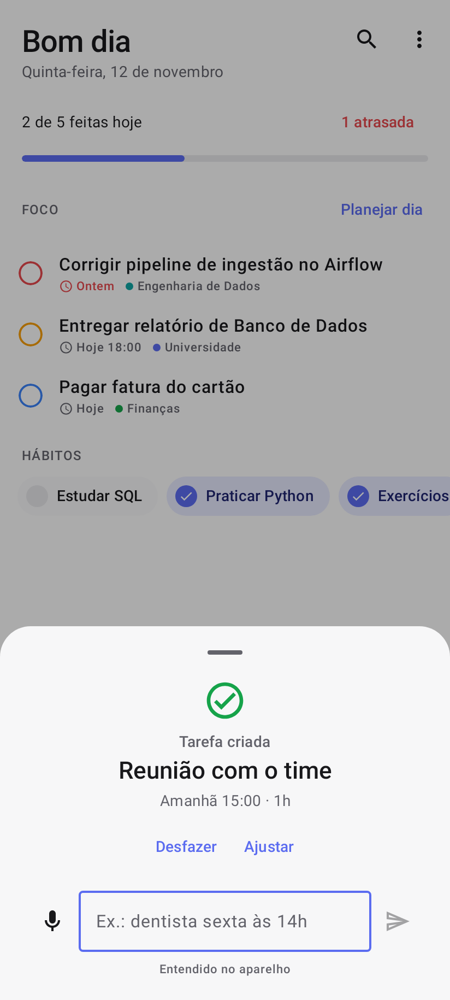 | 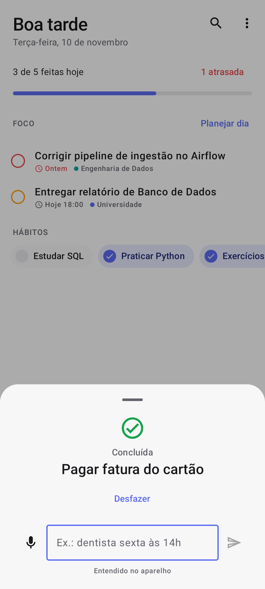 | 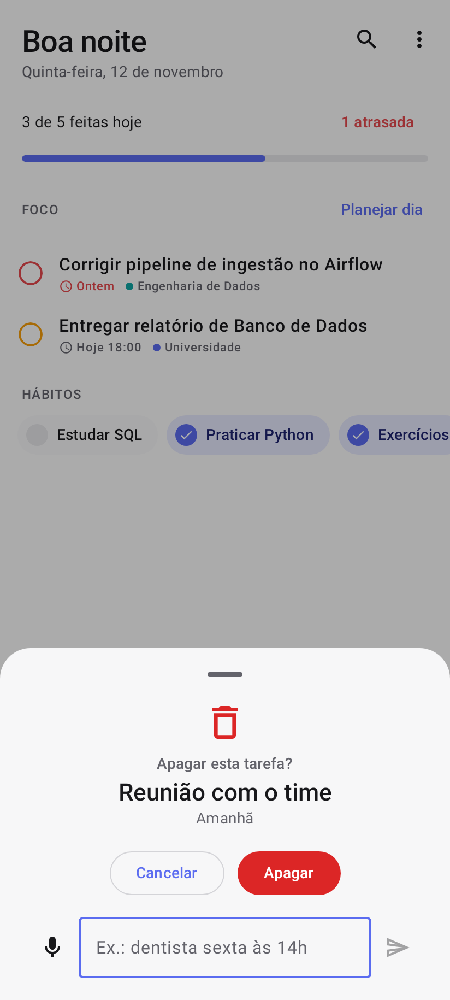 | 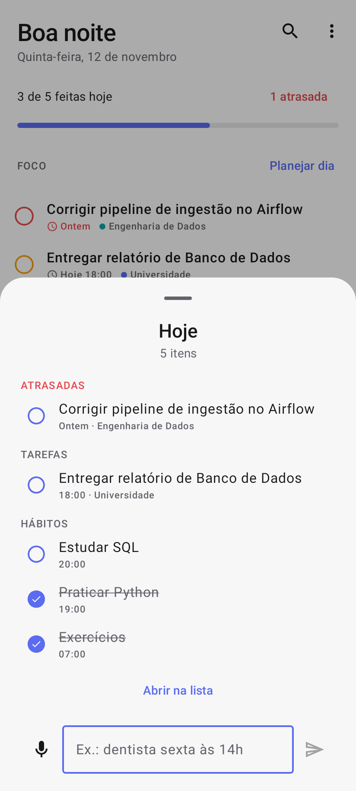 |

| Tarefas | Prioridade explicada | Meu dia | Hábitos | Agenda |
|---|---|---|---|---|
| 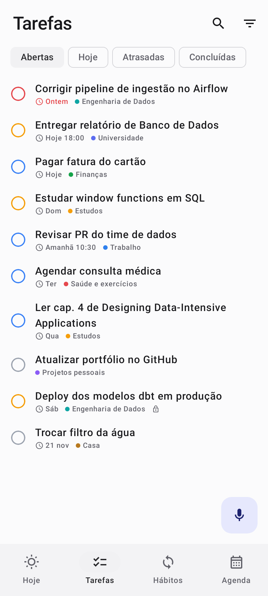 | 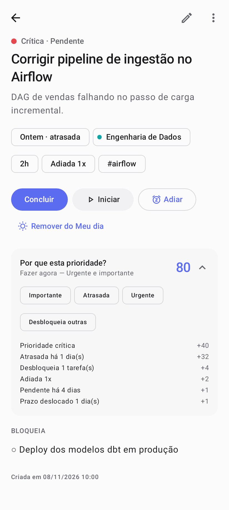 | 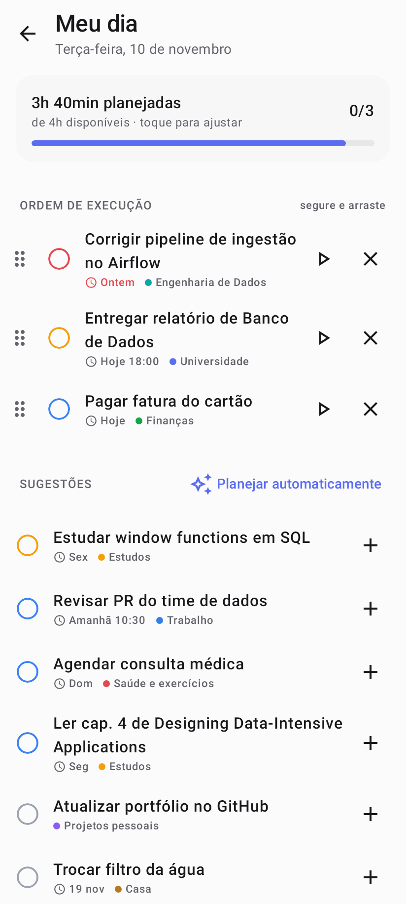 | 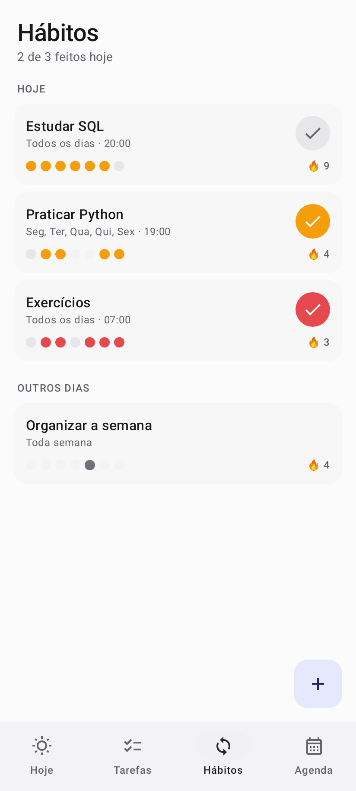 | 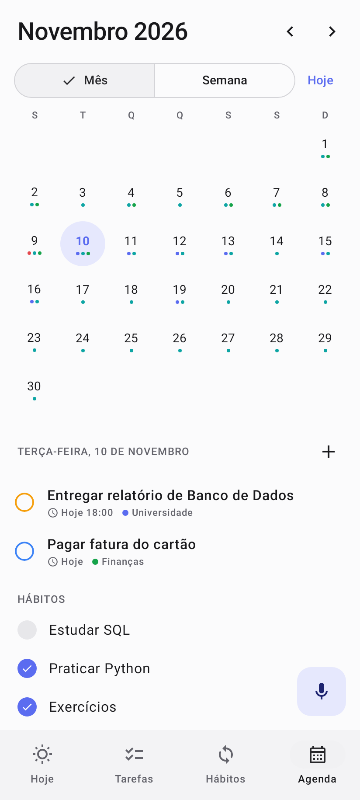 |

Renderizadas do app real com dados de exemplo (o app começa vazio). Para regerar:

```bash
./gradlew :app:testDebugUnitTest --tests "*ScreenshotTest*" -Pscreenshots
```

As imagens saem em `app/build/screenshots/`.

---

## Instalação no Galaxy S26

1. Copie `release/TaskFlow-1.3.0.apk` para o celular (cabo USB, Google Drive, e-mail para si mesmo etc.).
2. Abra o arquivo no app **Meus Arquivos**. Na primeira vez, o Android pede para permitir "Instalar apps desconhecidos" para o app usado para abrir — permita.
3. Se o **Auto Blocker** da Samsung estiver ativo (Configurações › Segurança e privacidade › Auto Blocker), desative-o temporariamente para instalar.
4. Ao abrir o TaskFlow, permita **notificações**. Para lembretes no minuto exato, vá em *Configurações do app › Notificações › Lembretes pontuais* e ative "Alarmes e lembretes".
5. Widget: segure a tela inicial › Widgets › TaskFlow · Prioridades.
6. Voz: no primeiro uso do microfone, permita o acesso. Para atalho de hardware, veja [Voz e IA do S26](#voz-e-ia-do-galaxy-s26).

Atualizações futuras precisam ser assinadas com a mesma chave; se a chave mudar, o Android exige desinstalar antes — exporte um backup em Configurações › Dados e importe depois.

---

## Voz e IA do Galaxy S26

Toque no **microfone** (botão flutuante) e fale. O mesmo campo aceita texto digitado.

| Você diz | O app faz |
|---|---|
| “Me lembra de pagar a fatura amanhã às 3 da tarde” | Cria **Pagar a fatura**, amanhã 15:00, com lembrete |
| “Reunião com o time toda segunda às 9h30 por uma hora” | Cria tarefa recorrente às segundas, 09:30, duração 1 h |
| “Estudar SQL todos os dias às 20h” · “Prova dia 20, urgente” | Recorrência diária · prazo dia 20, prioridade crítica |
| “Dentista daqui a 3 dias às 14h” · “Ligar pro banco semana que vem” | Datas relativas |
| “Criar dashboard de vendas na categoria engenharia de dados” | Define a categoria |
| “Já paguei a fatura” · “Concluí o relatório” · “Marca revisar PR como feito” | **Conclui** a tarefa certa (busca aproximada) |
| “Fiz exercícios” · “Estudei SQL” | Marca o **hábito** como feito hoje |
| “Apaga a tarefa estudar SQL” · “Exclui revisar PR” · “Pode remover o dentista” | **Apaga** a tarefa (pede confirmação) |
| “Apaga a reunião de amanhã” · “Cancela a reunião com cliente” · “Tira comprar pão da lista” | A data na frase escolhe entre tarefas de mesmo nome |
| “Apaga o hábito academia” | Apaga o hábito e o histórico dele (com confirmação e desfazer) |
| “O que eu tenho hoje?” · “Tenho algo na sexta?” · “Tarefas de amanhã” | **Lista** o dia: tarefas, atrasadas e hábitos que faltam |
| “Quais as tarefas dessa semana?” · “O que tenho na semana que vem?” · “Próximos 3 dias” | Lista o período |
| “O que está atrasado?” · “O que eu fiz hoje?” · “Quais tarefas eu concluí?” | Atrasadas · concluídas no dia · últimos 7 dias |
| “O que devo fazer agora?” · “Por onde eu começo?” | As 5 mais prioritárias, com o motivo da primeira |
| “Quais hábitos faltam hoje?” · “Tarefas de trabalho dessa semana” · “Tarefas sobre SQL” | Hábitos · por categoria · por assunto |

Depois de cada comando aparece o que foi entendido, com **Desfazer** (e **Ajustar** para abrir a tarefa). Se a frase servir para mais de uma tarefa, o app pergunta qual.

**Listar.** A resposta aparece na própria janela de voz:
- Atrasadas em vermelho; tarefas na ordem do dia (primeiro as com horário); hábitos já feitos riscados.
- Toque no círculo para **concluir ali mesmo**, ou na tarefa para abri-la.
- **Abrir na lista** leva para a tela de Tarefas com o mesmo filtro.

Quando o comando veio pelo microfone, o app também **lê a resposta em voz alta** com o leitor de texto do aparelho, por exemplo: “Hoje você tem 2 tarefas: Reunião com cliente, às 15:00; e Pagar fatura. Também 1 atrasada: Corrigir pipeline. Hábitos que faltam: Estudar SQL.” As confirmações também são faladas (“Criada: …”, “Pronto, … concluída.”). Pode ser desligado em Configurações › Voz e IA › Responder em voz alta. Perguntas digitadas não são lidas.

**Apagar é sempre confirmado.** O reconhecimento de voz e a busca aproximada podem errar, então o app mostra a tarefa encontrada (com data ou "concluída") e só apaga depois de você tocar em **Apagar**. Mesmo depois disso dá para **Desfazer**: a tarefa volta com o mesmo histórico, no "Meu dia" se estava planejada e reconectada às tarefas que dependiam dela. Também funciona com tarefas já concluídas.
- Infinitivo sozinho continua criando tarefa: "cancelar assinatura da Netflix" e "tirar o lixo amanhã" viram tarefas novas. Para apagar, use o imperativo ("cancela…", "apaga…") ou "a tarefa…".
- Se não achar o que apagar, o app oferece **Criar como nova tarefa**. Isso cobre o caso de "cancela a assinatura da academia" ser uma coisa a fazer.
- O Gemini Nano nunca decide apagar sozinho. A frase precisa ter uma palavra de apagar; o modelo só ajuda a escolher **qual** item.

### O que é possível integrar com a IA do S26 (verificado em novembro de 2026)

| Caminho | Situação para um app pessoal instalado por APK | No TaskFlow |
|---|---|---|
| **Gemini Nano** (modelo de IA que roda no próprio S26, via AICore + ML Kit Prompt API) | **Disponível.** O S26 tem Gemini Nano; apps de terceiros podem usá-lo, sem internet | **Integrado**: interpreta frases mais soltas e identifica qual tarefa você concluiu. Se não estiver disponível, o interpretador local assume |
| Gemini (assistente) chamando funções do app (**AppFunctions**, Android 16) | Biblioteca em *release candidate*; a integração com o Gemini está em **prévia fechada** para parceiros selecionados | Não implementado: não há como um app instalado por APK ser chamado pelo Gemini hoje |
| Gemini executando tarefas em outros apps (automação de tela) | Beta só para apps selecionados (delivery, mercado, transporte) nos EUA e na Coreia | Não se aplica |
| Bixby (cápsulas de terceiros) | Sem caminho público atual para integrar comandos de voz de apps de terceiros | Não implementado |
| **Abrir o app por voz ou botão** | Funciona: Bixby e Gemini abrem apps pelo nome, e o botão lateral abre qualquer app | **“TaskFlow Voz”**: entrada separada que abre direto no microfone |

**Atalhos práticos no S26**
- **Botão lateral:** Configurações › Recursos avançados › Botão lateral › Pressionar duas vezes › Abrir app › **TaskFlow Voz**. Dois toques e já está ouvindo.
- **Bixby ou Gemini:** “abrir TaskFlow Voz”.
- **Widget:** o ícone de microfone abre a captura por voz.
- **Ícone do app (pressão longa):** atalhos *Falar* e *Digitar tarefa*.
- **De qualquer app:** selecione um texto › *TaskFlow*, ou *Compartilhar › TaskFlow*. A frase é interpretada na hora; dá para mandar uma resposta do Gemini para virar tarefa.

**Privacidade.** O reconhecimento de voz usa o serviço do aparelho, preferindo o modo no aparelho. Em Configurações › Voz e IA, o app mostra se o Português offline está instalado e oferece o download. O Gemini Nano roda no AICore do sistema. A resposta falada usa o leitor de texto do aparelho (Samsung ou Google), que funciona offline com a voz em português instalada. O TaskFlow continua **sem permissão de internet**: a biblioteca do ML Kit traz um módulo de telemetria do Google, mas a permissão de rede dele foi removida no manifesto, então nada sai do app.

**Como a interpretação funciona** (`domain/voice`):
1. **Interpretador local de regras** (sempre ativo, determinístico). Identifica a intenção (criar × concluir) e extrai data (hoje, amanhã, dias da semana, “dia 20”, “15 de dezembro”, “daqui a 3 dias”, “semana que vem”), hora (“às 3 e meia da tarde”, “14:30”, “meio-dia”, “à noite”), duração, prioridade, categoria, tags, recorrência e lembrete. Também entende números por extenso.
2. **Gemini Nano** (opcional). Devolve um JSON com intenção, título, o trecho que fala de data, categoria e o número do item concluído.
3. **Fusão com validação.** Datas e horas vêm **sempre** das regras, porque modelos pequenos erram cálculo de data. O título do modelo só é aceito se as palavras estiverem na frase, a categoria só se existir, e o item concluído só se for real e tiver relação com o que foi dito. Qualquer coisa fora disso volta para as regras.
4. **Busca aproximada** (`TaskMatcher`). Tolera flexão verbal (paguei/pagar, estudei/estudar), acentos e erros de reconhecimento.

## Funcionalidades

| Área | O que faz |
|---|---|
| **Hoje** | Tela minimalista: saudação, uma linha de progresso do dia (com atrasadas, se houver), **Foco** (tarefas recomendadas) e hábitos do dia. Detalhes ficam a um toque. |
| **Tarefas** | Título, descrição, categoria, prioridade (baixa → crítica), criação, prazo, horário, duração, status (pendente / em andamento / concluída / arquivada), tags, subtarefas, lembrete, recorrência e **dependências**. Criar, editar, excluir (com desfazer), duplicar, concluir, adiar, arquivar, promover subtarefa a tarefa. Deslize → conclui, ← adia. |
| **Captura** | Microfone ou teclado no mesmo lugar (ver [Voz e IA](#voz-e-ia-do-galaxy-s26)). Digitando, também vale a sintaxe compacta `!alta`, `#tag`, `@categoria`. |
| **Busca e filtros** | Busca sem acento em título, descrição, categoria, tags e subtarefas. Na tela: Abertas, Hoje, Atrasadas, Concluídas. No menu de filtros: Amanhã, Esta semana, Sem prazo, Alta prioridade, Arquivadas, categorias e 4 ordenações. |
| **Priorização** | Pontuação 0–100 por regras locais, matriz urgente × importante, sinalizadores (urgente, importante, rápida, atrasada, adiada com frequência, bloqueada, desbloqueia outras) e cartão "Por que esta prioridade?" com cada fator e seus pontos. |
| **Meu dia** | Selecionar tarefas, ordem por **arrastar e soltar** (segure a alça; ações de acessibilidade "mover para cima/baixo"), tempo total vs. disponível, **alerta de sobrecarga**, iniciar/concluir, planejamento automático pelo ranking. |
| **Hábitos** | Separados das tarefas. Diário, dias específicos, semanal, mensal, a cada N dias. Últimos 7 dias (toque para corrigir um dia) e sequência atual. Pausar sem perder histórico. |
| **Agenda** | Mês e semana; marcadores de prazos, hábitos e concluídas; dia selecionado lista tudo e permite criar tarefa naquela data. Lê das mesmas tabelas (sem duplicação). |
| **Notificações** | Lembrete antes do prazo / no horário (com ações *Concluir* e *Adiar 1 dia*), aviso de atrasadas, resumo diário no horário escolhido, lembrete de hábito (ação *Feito*). Cada tipo pode ser desligado. Reagendadas após reiniciar o celular. |
| **Estatísticas** | Concluídas por dia (14 d) e por semana (8 sem), taxa de conclusão, evolução vs. semana anterior, volume e conclusão por categoria, tarefas mais adiadas, planejado × concluído. |
| **Categorias** | 9 iniciais (Universidade, Trabalho, Engenharia de Dados, Projetos pessoais, Finanças, Saúde e exercícios, Estudos, Casa, Outros), cor e ícone próprios, editáveis. |
| **Histórico** | Criação, edição (com resumo do que mudou), conclusão, reabertura, adiamento, arquivamento, exclusão, duplicação, promoção. Sobrevive à exclusão da tarefa. |
| **Backup** | Exporta/importa JSON pelo seletor de arquivos do Android (sem permissão de armazenamento). Importação valida formato, versão, enums, faixas, referências, duplicidades e ciclos **antes** de tocar no banco; aplica tudo numa transação (tudo ou nada). |
| **Widget** | Próximas tarefas prioritárias com botão de conclusão rápida, microfone para falar, toque abre a tarefa. |
| **Tema** | Claro, escuro ou sistema; opção Material You. Edge-to-edge. |

---

## 1. Arquitetura

MVVM + Clean Architecture em camadas, com dependências apontando para dentro:

```
presentation (Compose + ViewModels/StateFlow)
      │ usa
      ▼
domain  (modelos puros, regras, use cases, interfaces de repositório)   ◄── sem Android
      ▲ implementa
      │
data    (Room, DataStore, backup JSON)      notifications / widget (AlarmManager, WorkManager, Glance)
```

Decisões:

- **Domínio puro em Kotlin** (`domain/engine`): priorização, recorrência, sequências, prazos, filtros, estatísticas e parser da captura rápida não dependem de Android → testáveis em JVM e determinísticos (`TimeProvider` injetável).
- **Use cases** para toda mutação de tarefa (`SaveTask`, `SetTaskDone`, `Postpone`, `Delete`/`Restore`, `Duplicate`, `PromoteSubtask`…). Cada um valida, grava, registra histórico e sincroniza lembretes no mesmo fluxo → editar/excluir/concluir não deixa estado inconsistente.
- **Erros centralizados**: `AppResult`/`AppError` (`core/AppResult.kt`); a UI mostra a mensagem via snackbar.
- **Reatividade**: Room expõe `Flow`; ViewModels combinam fluxos em um `StateFlow` de estado de tela.
- **Hilt** para DI, inclusive em Workers (`@HiltWorker`), BroadcastReceivers e widget (`EntryPoint`).
- **Lembretes pontuais com AlarmManager** (WorkManager não garante minuto exato); **WorkManager** para tarefas periódicas (resumo diário, verificação de atrasadas).
- **Um módulo Gradle com pacotes por camada**. Avaliei separar em módulos Gradle (`:core`, `:domain`, `:data`…); para um app pessoal isso aumenta tempo de build e configuração sem ganho real agora. Os pacotes já respeitam as fronteiras (domain não importa data/presentation), então a extração para módulos é mecânica quando fizer sentido.

## 2. Estrutura de diretórios

```
app/src/main/java/com/taskflow/
├── core/              AppResult/AppError, TimeProvider
├── domain/
│   ├── model/         Task, Subtask, Category, Habit, RecurrenceRule, HistoryEntry…
│   ├── engine/        PriorityEngine, RecurrenceCalculator, HabitStreaks, DueRules,
│   │                  TaskFilters, ProductivityCalculator, QuickCaptureParser
│   ├── repository/    interfaces (TaskRepository, …, ReminderScheduler, OnDeviceAi)
│   ├── voice/         VoiceCommandParser, TaskMatcher, VoiceInterpreter (NLU em pt-BR)
│   └── usecase/       TaskUseCases, OtherUseCases
├── data/
│   ├── local/         Entities, DAOs, TaskFlowDatabase, Mappers
│   ├── repository/    implementações Room
│   ├── settings/      DataStore (SettingsRepository)
│   ├── ai/            GeminiNanoAi (ML Kit Prompt API / AICore) + NanoPrompt
│   └── backup/        DTOs, BackupValidator, BackupManager
├── di/                módulos Hilt
├── notifications/     Notifier, AlarmReminderScheduler, Receivers, Workers, ReminderSync
├── widget/            Glance widget + ação de concluir
├── navigation/        Routes, TaskFlowNavHost (barra inferior, botão de microfone)
└── presentation/      theme, components, dashboard, tasks, taskdetail, taskedit, myday,
                       habits, calendar, stats, categories, settings, history,
                       voice (SpeechInput, VoiceCaptureSheet, VoiceCaptureActivity)
app/src/test/…         testes de domínio, use cases, Room/backup (Robolectric) e UI
app/schemas/           schema exportado do Room (base para migrações futuras)
```

## 3. Modelo de dados (Room, v1)

```
categories(id, name UNIQUE, colorArgb, icon, position)
tasks(id, title, description, categoryId→categories SET NULL, priority, status,
      createdAt, updatedAt, dueDate[epochDay], dueTime[min], originalDueDate,
      estimatedMinutes, completedAt, startedAt, postponeCount, reminderMinutesBefore, recurrence)
subtasks(id, taskId→tasks CASCADE, title, done, position)
tags(id, name UNIQUE)            task_tags(taskId→tasks CASCADE, tagId→tags CASCADE)
task_dependencies(taskId→tasks CASCADE, dependsOnId→tasks CASCADE)
habits(id, title, description, categoryId→categories SET NULL, rule, reminderTime, createdAt, startDate, archived)
habit_logs(habitId→habits CASCADE, date)          -- uma linha por dia cumprido
day_plan(date, taskId→tasks CASCADE, position)     -- "Meu dia"
day_meta(date, availableMinutes)
history(id, taskId [sem FK, sobrevive à exclusão], taskTitle, type, details, timestamp)
```

- Recorrência de **tarefa**: ao concluir, cria a próxima ocorrência (nova linha), preservando o histórico de cada execução. **Hábito**: uma regra + log de datas, sem gerar tarefas — por isso não se misturam.
- `originalDueDate` guarda o primeiro prazo; `postponeCount` conta adiamentos → base para "atraso em relação ao prazo original" e "constantemente adiadas".
- Tags órfãs são removidas automaticamente; dependências circulares são bloqueadas na gravação e na importação.

## 4. Fluxo de navegação

```
Barra inferior: Hoje · Tarefas · Hábitos · Agenda      (+ microfone: falar/digitar · em Hábitos: novo hábito)
Hoje ──► Planejar dia (Meu dia) | detalhe da tarefa ──► editar
   └─ menu ⋮ ─► Estatísticas · Categorias · Histórico · Configurações
Tarefas (busca/filtros) ─► detalhe ─► editar | dependências ─► outra tarefa
Agenda ─► dia ─► detalhe / nova tarefa na data
Notificação / widget / atalho ─► deep link para tarefa, filtro de atrasadas, hábitos ou captura rápida
TaskFlow Voz (botão lateral, Bixby/Gemini “abrir”, widget, compartilhar) ─► captura por voz sobre qualquer tela
```

## 5. Priorização inteligente

`domain/engine/PriorityEngine.kt` — pontuação por regras, limitada a 0–100, cada fator vira uma linha legível:

| Fator | Pontos |
|---|---|
| **Importância** (prioridade do usuário) | baixa 8 · média 18 · alta 30 · crítica 40 |
| **Urgência** (proximidade do prazo) | atrasada 30 + 2/dia (máx. +10) · hoje 26 (30 se faltam ≤ 2 h) · amanhã 20 · ≤ 3 d 13 · ≤ 7 d 7 · ≤ 14 d 3 · depois 1 |
| **Duração** | ≤ 15 min +6 (*rápida*) · ≤ 30 min +3 · ≥ 4 h sem urgência −3 |
| **Tempo pendente** | +1 a cada 3 dias (máx. +6) |
| **Dependências** | desbloqueia N abertas: +4·N (máx. +12) · aguardando dependência aberta: −25 (*bloqueada*, vai para o fim) |
| **Adiamentos / deslocamento** | +2 por adiamento (máx. +10; ≥ 3 = *adiada com frequência*) · +1 por dia que o prazo deslizou do original (máx. +6) |

**Urgência ≠ importância**: a classificação usa a matriz de Eisenhower calculada separadamente — *urgente* = atrasada ou vence até amanhã; *importante* = prioridade alta/crítica → **Fazer agora**, **Planejar**, **Resolver rápido**, **Depois**.
**Foco de hoje** = até 5 tarefas não bloqueadas que estão no "Meu dia", vencem hoje/atrasadas, são "Fazer agora" ou pontuam ≥ 50.

## 6. Etapas executadas

1. **Planejamento** — arquitetura, entidades, banco, navegação e design system (este documento).
2. **MVP** — Room + repositórios, use cases, priorização, Início, CRUD completo, categorias, Meu dia. Compilação validada.
3. **Produtividade** — recorrências, hábitos e sequências, agenda mês/semana, notificações (AlarmManager + WorkManager), estatísticas.
4. **Avançado** — widget Glance, backup/restauração validados, histórico, captura rápida com linguagem natural, atalho, desfazer exclusão, acessibilidade.
5. **Testes e distribuição** — testes automatizados, correção dos bugs encontrados, APK release com R8 e assinatura.
6. **v1.1 — Voz e minimalismo** — comandos de voz (criar/concluir), Gemini Nano no aparelho, entradas do sistema (botão lateral, Bixby/Gemini, widget, compartilhar), interface simplificada (4 abas, linhas e cartões enxutos). Kotlin 2.3, Room 2.8, Hilt 2.58.
7. **v1.2 — Apagar por voz** — tarefas e hábitos existentes (inclusive concluídos), com confirmação, escolha entre parecidos e desfazer completo (mesmo id, Meu dia e dependências).
8. **v1.3 — Listar por voz** — perguntas sobre o dia, períodos, atrasadas, concluídas, prioridades, hábitos, categoria e assunto; resposta na tela (com concluir no lugar) e em voz alta. 139 testes.

---

## Compilação

Requisitos: JDK 17+ e Android SDK (platform 35, build-tools 35). Android Studio Ladybug ou mais recente abre o projeto diretamente.

```bash
./gradlew :app:testDebugUnitTest
```

```bash
./gradlew :app:assembleRelease
```

O APK sai em `app/build/outputs/apk/release/app-release.apk`.

**Assinatura:** o build release lê `keystore.properties` na raiz (fora do Git, ver `.gitignore`):

```properties
storeFile=keystore/taskflow-release.jks
storePassword=...
keyAlias=taskflow
keyPassword=...
```

Sem esse arquivo, o release é assinado com a chave de debug (instala normalmente, mas não atualiza por cima de um APK assinado com outra chave). O `release/TaskFlow-1.0.0.apk` foi assinado com uma chave release gerada no ambiente de build; para publicar atualizações por cima dele é preciso guardar essa mesma chave. Gerar uma nova:

```bash
keytool -genkeypair -keystore keystore/taskflow-release.jks -alias taskflow -keyalg RSA -keysize 4096 -validity 36500
```

## Testes

| Suíte | Cobre |
|---|---|
| `PriorityEngineTest` | cada fator, quadrantes, rápidas, adiadas, bloqueio/desbloqueio, ranking, foco de hoje |
| `RecurrenceTest` | diária/intervalo, dias da semana, semanal, mensal (dia 31 → fev 28), N dias, codificação, sequências e taxa |
| `ProductivityAndRulesTest` | regras de vencimento (data + hora), semana, filtros, busca, relatório, progresso diário |
| `QuickCaptureParserTest` | todos os tokens da captura rápida |
| `TaskUseCasesTest` | validação, prazo original, ciclo de dependências, lembretes, conclusão/reabertura idempotentes, recorrência, adiamento, exclusão + desfazer, duplicação, promoção de subtarefa, captura rápida |
| `BackupValidatorTest` | formato, versão, referências, valores inválidos, duplicidades, ciclos |
| `RoomRepositoryTest` (Robolectric) | persistência real com cascatas, categoria excluída, ordem do plano, backup ida-e-volta, importação inválida não altera dados |
| `VoiceCommandParserTest` | intenção criar × concluir × apagar (inclusive "cancelar assinatura" continuar criando), datas/horas faladas (números por extenso, “3 e meia da tarde”, relativas), duração, prioridade, categoria, recorrência, lembrete, títulos limpos, busca aproximada e ambiguidade |
| `VoiceInterpreterTest` | fusão regras + Gemini Nano (título inventado rejeitado, categoria inexistente ignorada, alvo inválido descartado, modelo nunca apaga sozinho, modelo pode reconhecer perguntas sem sobrepor comandos explícitos), parsing do JSON do modelo, executar e desfazer (criar, concluir, recorrência, hábito, apagar tarefa e hábito) |
| `VoiceQueryTest` | reconhece perguntas (hoje, outros dias, períodos, atrasadas, concluídas, prioridades, hábitos, categoria com sinônimo, assunto) e não confunde comandos (“ver o filme amanhã”, “lista de exercícios para sexta”, “agenda reunião”) |
| `VoiceAnswerTest` | monta a resposta: seções, ordem, texto falado exato (incluindo “nada pendente”, “No sábado…”), filtro equivalente |
| `VoiceViewModelTest` (Robolectric) | pergunta falada gera resposta em voz alta e digitada não; concluir pela lista atualiza a resposta; rotas de “Abrir na lista” |
| `AppSmokeTest` (Robolectric + Compose) | sobe o app real: cria e conclui tarefa por frase, desfaz; apaga por frase com confirmação, cancela, desfaz e "criar como nova tarefa"; pergunta “o que eu tenho hoje?”, conclui pela lista e abre a lista filtrada; detalhe, todas as abas, hábito, telas secundárias, edição, Meu dia, adiar, excluir e desfazer |
| `VoiceEntryTest` | “Compartilhar → TaskFlow”: a frase compartilhada vira tarefa com data e hora |
| `ScreenshotTest` | gera as capturas de tela acima (só roda com `-Pscreenshots`) |

## Privacidade e permissões

Sem permissão de **INTERNET**: o app não tem como transmitir dados. A permissão que a biblioteca do ML Kit adicionaria foi removida no manifesto com `tools:node="remove"`. Backup do Android e transferência entre aparelhos estão desativados; o backup é só o JSON que você exporta. Permissões pedidas: notificações, alarmes exatos (opcional), reagendar após reinício, vibração e **microfone** (só quando você toca para falar). `ACCESS_NETWORK_STATE` e `FOREGROUND_SERVICE` vêm do WorkManager e `BIND_SERVICE` do AICore vem do Gemini Nano; nenhuma delas dá acesso à rede.

## Limitações conhecidas

- Validado em testes automatizados (incluindo o app completo sob Robolectric), mas **não executado num aparelho físico** durante o desenvolvimento. Vale testar no S26 notificações, widget, microfone e Gemini Nano: o ambiente de build não tem microfone nem AICore, então a voz foi testada com o mesmo texto digitado.
- O Gemini Nano depende do AICore do aparelho e da disponibilidade do modelo; se não estiver pronto, o app usa o interpretador local sem avisar erro. A integração com o **assistente** Gemini (AppFunctions) ainda não está aberta a apps instalados por APK.
- Sem o pacote de Português offline, o reconhecimento de voz usa o serviço do sistema, que pode processar o áudio na nuvem do provedor (Google/Samsung). O TaskFlow em si não acessa a rede.
- Sem "Alarmes e lembretes" permitido, o Android pode atrasar lembretes alguns minutos (modo econômico).
- O widget se atualiza a cada alteração enquanto o app está em memória, ao concluir pelo próprio widget/notificação e a cada 30 min.
- Interface somente em português (pt-BR).
